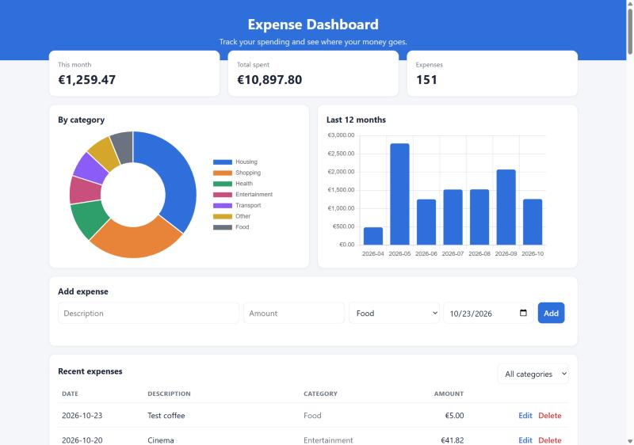

# Expense Tracker Dashboard

A full-stack web app for tracking personal expenses, with a live dashboard and charts.
**JavaScript frontend + Python (Flask) REST API + SQLite database.**



## Features

- **Add, edit and delete expenses** without page reloads.
- **Dashboard cards:** spending this month, total spent, number of expenses.
- **Charts:** spending by category (doughnut) and the last 12 months (bar chart).
- **Filter** the table by category.
- **Server-side validation** with clear error messages (amount, date, category, description).
- **Responsive layout** for desktop and phones.
- **Safe by design:** parameterized SQL queries (no SQL injection) and `textContent` rendering (no XSS).
- **Automated tests** for the API.

## Tech stack

| Layer | Technology |
|---|---|
| Frontend | HTML, CSS, vanilla JavaScript (`fetch` API), Chart.js |
| Backend | Python, Flask (REST API) |
| Database | SQLite, aggregations with SQL (`GROUP BY`, `strftime`) |
| Tests | `unittest` + Flask test client |

## Setup and usage

```bash
pip install -r requirements.txt

python app.py --demo     # adds 150 sample expenses, then starts the server
python app.py            # starts with your own data
```

Open http://localhost:5000.

Run the tests:

```bash
python -m unittest test_app.py
```

## REST API

| Method | Endpoint | Description |
|---|---|---|
| GET | `/api/expenses?category=Food` | List expenses (optional filter) |
| POST | `/api/expenses` | Create an expense |
| PUT | `/api/expenses/<id>` | Update an expense |
| DELETE | `/api/expenses/<id>` | Delete an expense |
| GET | `/api/stats` | Totals and chart data |

Example request:

```bash
curl -X POST http://localhost:5000/api/expenses \
  -H "Content-Type: application/json" \
  -d '{"description": "Lunch", "amount": 12.5, "category": "Food", "spent_on": "2026-10-23"}'
```
